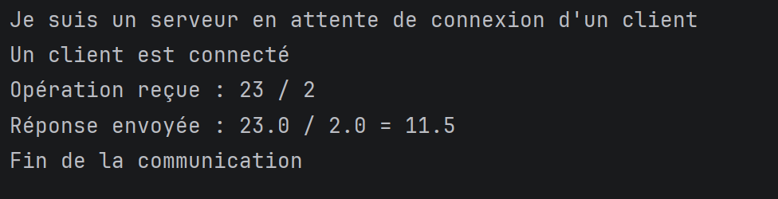
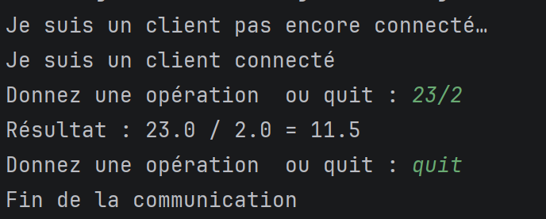
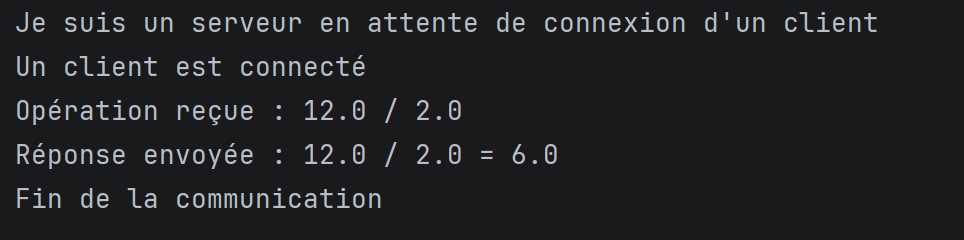
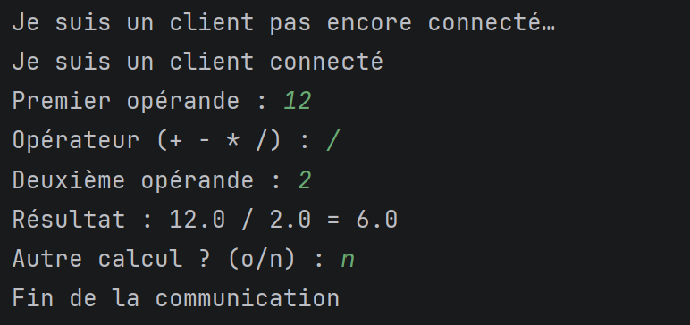

# TP2 - Développement d'Applications Réparties (LSI3)

**Étudiante :** Rahma Saidi  
**Matière :** Développement d'Applications Réparties  
**Année universitaire :** 2026 - 2027

---

# Présentation du TP

Ce TP a pour objectif de mettre en œuvre une communication Client/Serveur en Java à l'aide des sockets TCP.

Le travail est composé de deux activités :

- Activité 2-1 : échange de chaînes de caractères entre le client et le serveur.
- Activité 2-2 : échange d'objets sérialisés entre le client et le serveur.

L'objectif est de comprendre le fonctionnement des sockets, des flux d'entrée/sortie ainsi que la sérialisation d'objets dans une application répartie.

---

# Structure du projet

```text
src
│
├── ClientPackage
│   ├── Client.java
│   └── client2.java
│
├── ServerPackage
│   ├── Server.java
│   └── Server2.java
│
└── sharedPackage
    └── Operation.java
````

---

# Activité 2-1 : Échange de chaînes de caractères

## Objectif

Le client saisit une opération mathématique sous forme d'une chaîne :

```text
55 * 25
```

Le programme vérifie d'abord que la syntaxe est correcte grâce à une expression régulière.

Si la syntaxe est valide :

* Le premier opérande est envoyé au serveur.
* L'opérateur est envoyé.
* Le deuxième opérande est envoyé.

Le serveur réalise ensuite le calcul puis renvoie le résultat.

---

# Validation des données

Le client utilise le motif suivant :

```java
Pattern.compile(
    "^\\s*(-?\\d+(?:\\.\\d+)?)\\s*([+\\-*/])\\s*(-?\\d+(?:\\.\\d+)?)\\s*$"
);
```

### Exemples d'opérations valides

```text
55 * 25
20 + 5
-5 + 7
```

### Exemples d'opérations invalides

```text
25 ** 5
abc + 3
10 ++ 8
```

Ainsi, aucune opération invalide n'est envoyée au serveur.

---

# Flux utilisés

## Client

```java
PrintWriter
BufferedReader
```

## Serveur

```java
BufferedReader
PrintWriter
```

La communication est basée sur l'échange de chaînes de caractères. Pour garantir un encodage UTF-8, les flux doivent être configurés en conséquence.

---

# Fonctionnement du serveur

Le serveur :

1. Attend une connexion sur le port 1234.
2. Accepte la connexion du client.
3. Lit les trois lignes envoyées.
4. Transforme les opérandes en nombres.
5. Effectue le calcul.
6. Renvoie le résultat au client.

Les opérations prises en charge sont :

```text
+
-
*
/
```

Une vérification supplémentaire est réalisée pour empêcher la division par zéro.

---

# Exécution

## Serveur



## Client



---

# Résultats obtenus


| Saisie     | Réponse                               |
| ---------- | ------------------------------------- |
| `55 * 25`  | `55.0 * 25.0 = 1375.0`                |
| `10 + 4`   | `10.0 + 4.0 = 14.0`                   |
| `100 - 42` | `100.0 - 42.0 = 58.0`                 |
| `10 / 4`   | `10.0 / 4.0 = 2.5`                    |
| `10 / 0`   | Erreur : division par zéro impossible |
| `abc + 3`  | Syntaxe invalide                      |
| `25 ** 55` | Syntaxe invalide                      |
| `quit`     | Fin de la communication               |

---

# Analyse

Cette activité montre comment transmettre des données sous forme de chaînes de caractères.

Le client joue un rôle important puisqu'il filtre les saisies incorrectes avant leur envoi.

Le serveur reçoit les données et effectue les calculs. L'utilisation de `PrintWriter` avec l'option `autoFlush` permet d'envoyer immédiatement les messages lorsque la méthode `println()` est utilisée.


---

# Activité 2-2 : Échange d'objets sérialisés

## Objectif

Dans cette activité, les informations de l'opération ne sont plus envoyées sous forme de trois chaînes de caractères.

Elles sont regroupées dans un objet Java nommé :

```java
Operation
```

Cet objet est ensuite envoyé au serveur grâce à la sérialisation.

---

# Classe Operation

La classe commune contient les attributs suivants :

```java
private double operande1;
private char operateur;
private double operande2;
```

Elle implémente l'interface :

```java
Serializable
```

afin de pouvoir être transmise à travers le réseau.

L'attribut suivant permet d'identifier la version de la classe lors de la désérialisation :

```java
private static final long serialVersionUID = 1L;
```

La classe `Operation` est utilisée par le client et le serveur pour échanger les données de l'opération mathématique.

---

# Flux utilisés

## Envoi

```java
ObjectOutputStream
```

## Réception

```java
ObjectInputStream
```

Ces flux permettent respectivement d'envoyer et de recevoir des objets Java sérialisés.

---

# Fonctionnement

Le client :

1. Saisit les deux opérandes et l'opérateur.
2. Crée un objet `Operation`.
3. Envoie l'objet au serveur.
4. Attend la réponse.
5. Affiche le résultat.

Le serveur :

1. Reçoit un objet `Operation`.
2. Récupère les valeurs grâce aux méthodes getters.
3. Effectue le calcul.
4. Renvoie le résultat au client.

---

# Point important

L'ordre de création des flux doit être respecté :

```java
ObjectOutputStream
ObjectInputStream
```

Cet ordre doit être appliqué du côté client et du côté serveur. La création du `ObjectOutputStream`, suivie de son vidage avec `flush()`, permet d'envoyer l'en-tête du flux et d'éviter un blocage lors de l'établissement de la communication.

---

# Fin de communication

Lorsque l'utilisateur choisit de terminer la communication, le client envoie :

```java
"FIN"
```

Le serveur quitte alors sa boucle de réception lorsque l'objet reçu n'est plus une instance de `Operation` :

```java
while (recu instanceof Operation)
```

Le serveur ferme ensuite la connexion.

---

# Exécution

## Serveur



## Client



---

# Résultats obtenus

| Test       | Résultat                              |
| ---------- | ------------------------------------- |
| `5 + 3`    | `5.0 + 3.0 = 8.0`                     |
| `6 * 7`    | `6.0 * 7.0 = 42.0`                    |
| `100 - 42` | `100.0 - 42.0 = 58.0`                 |
| `10 / 2`   | `10.0 / 2.0 = 5.0`                    |
| `10 / 0`   | Erreur : division par zéro impossible |
| `FIN`      | Communication terminée                |

---

# Comparaison entre les deux activités

| Activité 2-1                         | Activité 2-2                               |
| ------------------------------------ | ------------------------------------------ |
| Données envoyées sous forme de texte | Données envoyées sous forme d'objet        |
| `PrintWriter` / `BufferedReader`     | `ObjectOutputStream` / `ObjectInputStream` |
| Trois messages envoyés               | Un objet contenant les données envoyé      |
| Pas de classe commune nécessaire     | Utilisation de la classe `Operation`       |

---

# Compétences acquises

Au cours de ce TP, j'ai appris à :

* Utiliser les sockets TCP.
* Créer une architecture Client/Serveur.
* Utiliser les flux de communication Java.
* Manipuler les expressions régulières.
* Sérialiser des objets Java.
* Partager une classe entre plusieurs applications.
* Gérer les erreurs de calcul.
* Fermer correctement les connexions réseau.

---

# Conclusion

Ce TP m'a permis de comprendre de manière pratique le fonctionnement des applications réparties en Java.

La première activité a illustré l'échange de données textuelles via les sockets TCP, tandis que la seconde a introduit la sérialisation d'objets grâce à la classe `Operation`.

Ces deux approches montrent différentes méthodes de communication entre un client et un serveur et constituent une base essentielle pour le développement d'applications distribuées plus complexes.

```
